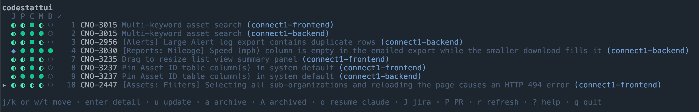
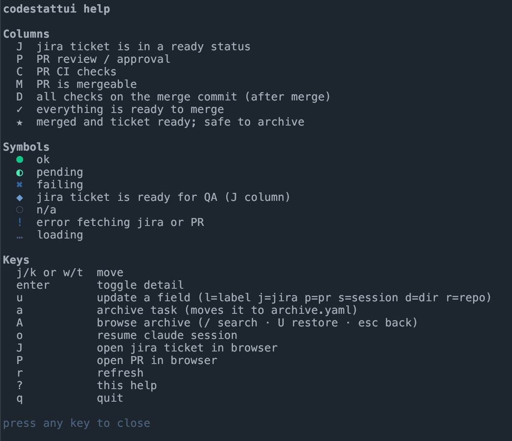
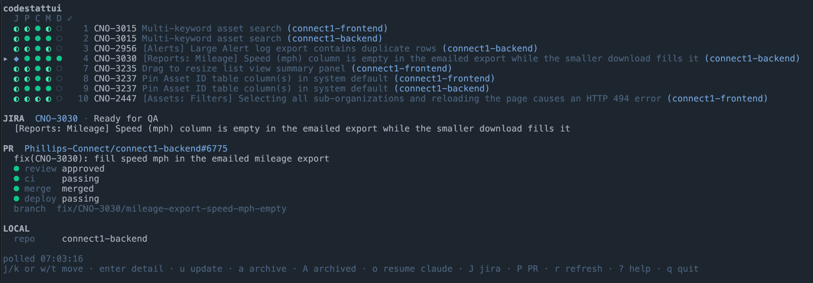

# codestattui

A lightweight terminal dashboard that shows the status of your in-flight tasks at a glance, using live data from JIRA and GitHub. Each task is one line with indicators for ticket status, CI, review approval, mergeability, and post-merge checks, so you can tell what is ready to merge, what is blocked, and what can be archived.

Tasks live in a plain YAML file, so you (or an AI agent) can add, update, and remove them from the CLI while the TUI is open. The TUI picks up changes within a couple of seconds.



## Requirements

### To run

| Requirement | Why | Notes |
| --- | --- | --- |
| [`gh`](https://cli.github.com/) (GitHub CLI) | Fetches PR review, CI, and merge status | Run `gh auth login` first. It needs read access to the repos you track. |
| [`acli`](https://developer.atlassian.com/cloud/acli/) (Atlassian CLI) | Fetches JIRA ticket status and summary | Must be logged in to your Atlassian site. Also used by `J` to open a ticket in the browser. |
| A terminal with alt-screen and Unicode support | The TUI uses `●◐✖◆○★✓` and braille spinners | Works in narrow panes such as tmux splits. |

Optional:

| Requirement | Used for |
| --- | --- |
| [`claude`](https://claude.com/claude-code) (Claude Code CLI) | `o` resumes a task's Claude session (`claude --resume <session> --remote-control`). |
| [kitty](https://sw.kovidgoyal.net/kitty/) with `allow_remote_control` enabled in `kitty.conf` | When running inside kitty, `o` opens the session in a split beside the TUI. Without it, the session resumes in place. |
| `git` | Infers a task's repo from `--dir` when `--repo` is not given. |
| `open` (macOS) or `xdg-open` (Linux) | `P` opens the PR in your browser. |

If you only use one data source, the other CLI is not needed for tasks that don't reference it. A task with only `--pr` needs just `gh`, unless a JIRA key can be found in the PR branch name or title.

### To build

- [Go](https://go.dev/dl/) matching the version in `go.mod` (currently `1.27.2`)
- Dependencies are fetched automatically by `go build`: Bubble Tea, Lip Gloss, and `yaml.v3`.

## Install

```sh
git clone https://github.com/ryanharris-dev/codestattui.git
cd codestattui
go build -o codestattui .
mkdir -p ~/.local/bin
cp codestattui ~/.local/bin/codestattui
```

Make sure `~/.local/bin` is on your `PATH`.

On macOS, overwriting an installed binary in place can leave a stale cached code signature, and the kernel will then kill the binary (`zsh: killed`). When reinstalling, remove the old binary first and re-sign the new one:

```sh
go build -o codestattui . \
  && rm -f ~/.local/bin/codestattui \
  && cp codestattui ~/.local/bin/codestattui \
  && codesign --force --sign - ~/.local/bin/codestattui
```

Restart the TUI after reinstalling to pick up the change.

## Quick start

```sh
# Track a ticket and its PR
codestattui add --jira ABC-123 --pr owner/repo#456

# Open the dashboard
codestattui
```

## CLI reference

Output of `codestattui --help`:

```
codestattui - task status from JIRA and GitHub

Usage:
  codestattui                       open the TUI
  codestattui list                  print tasks
  codestattui add [--jira KEY|URL] [--pr URL|owner/repo#N] [--label TEXT] [--session ID] [--dir PATH] [--repo NAME]
  codestattui update <id|jira|pr|label> [--jira KEY|URL] [--pr URL] [--label TEXT] [--session ID] [--dir PATH]
                                    [--repo NAME]   (selects among tasks sharing a ticket)
  codestattui rm <id|jira|pr|label> [--repo NAME]
  codestattui archive <id|jira|pr|label> [--repo NAME]     move a task out of the active list
  codestattui unarchive <id|jira|pr|label> [--repo NAME]   bring it back
  codestattui archived [search words...]                   list/search archived tasks

Files live in $CODESTATTUI_HOME or ~/.config/codestattui (tasks.yaml, archive.yaml, config.yaml).
```

`help`, `-h`, and `--help` all print this text.

### Commands

#### `codestattui`

Opens the TUI. See [TUI usage](#tui-usage).

#### `codestattui list`

Prints the active tasks as tab-separated lines: `id  jira  repo  pr  label  session`. Handy for scripts and agents.

#### `codestattui add`

Adds a task. At least one of `--jira` or `--pr` is required.

| Flag | Description |
| --- | --- |
| `--jira KEY\|URL` | JIRA key (`ABC-123`) or a browse URL containing one. |
| `--pr URL\|owner/repo#N` | GitHub PR URL or `owner/repo#N`. Stored normalized as `owner/repo#N`. |
| `--label TEXT` | Display name shown in the list. Defaults to the JIRA key, then the PR. |
| `--session ID` | Claude Code session id, so `o` in the TUI can resume it. |
| `--dir PATH` | Directory the session was started in. Defaults to the current directory when `--session` is given. Claude sessions are per-directory. |
| `--repo NAME` | Repository the work happens in. Defaults to the repo name from `--pr`, or the git repo containing `--dir`. |

A new task gets the next free numeric id. Adding fails if another task already tracks the same PR, or the same JIRA key in the same repo. The same ticket can have one row per repo, each with its own PR and session.

If you give only `--pr`, the JIRA key is looked up from the PR's branch name, then its title.

```sh
codestattui add --jira ABC-123 --pr https://github.com/acme/api/pull/42 --label "auth refactor"
codestattui add --pr acme/web#17 --session 3f2c9a1e-... --dir ~/code/web
```

#### `codestattui update <id|jira|pr|label>`

Changes fields on an existing task. Only the flags you pass are changed, and passing a flag with an empty value clears that field. It takes the same flags as `add`.

The task can be addressed by id, JIRA key, PR ref, or label. An exact id always wins. If a key matches several tasks (for example one ticket across repos), pass `--repo NAME` to pick one. Here `--repo` only selects the task. It does not change its repo.

```sh
codestattui update 3 --pr acme/api#99
codestattui update ABC-123 --repo web --label "login fix"
codestattui update 3 --session ""        # clear the session
```

#### `codestattui rm <id|jira|pr|label> [--repo NAME]`

Permanently removes a task from the active list. Use `archive` to keep a record.

#### `codestattui archive <id|jira|pr|label> [--repo NAME]`

Moves a task from `tasks.yaml` to `archive.yaml`, out of the active list and no longer polled. Records the archive date.

#### `codestattui unarchive <id|jira|pr|label> [--repo NAME]`

Moves an archived task back to the active list.

#### `codestattui archived [search words...]`

Lists archived tasks, newest first, optionally filtered by search words. Output is tab-separated: `id  archived-date  jira  repo  pr  label  session`.

## Configuration

### Data directory

All state is stored in `$CODESTATTUI_HOME`, or `~/.config/codestattui` if that variable is unset.

| File | Contents |
| --- | --- |
| `tasks.yaml` | Active tasks. Written atomically, so it is safe to edit by hand or from scripts while the TUI runs. |
| `archive.yaml` | Archived tasks. Never polled. |
| `config.yaml` | Optional settings (below). |

### `config.yaml`

Every field is optional. Missing fields fall back to the defaults shown.

```yaml
poll_interval: 60s          # how often GitHub and JIRA are polled (minimum 5s)
ready_statuses:             # JIRA statuses that count as "ready" (case-insensitive)
  - QA Approved
qa_statuses:                # JIRA statuses that mean "waiting on QA" (shown as ◆)
  - Ready for QA
```

### `tasks.yaml` format

```yaml
tasks:
  - id: "1"
    label: auth refactor    # optional
    jira: ABC-123           # optional if pr is set
    pr: acme/api#42         # optional if jira is set
    repo: api               # optional
    session: 3f2c9a1e-...   # optional, Claude Code session id
    dir: /Users/me/code/api # optional, where the session was started
```

## TUI usage

Run `codestattui` with no arguments. The list refreshes on the poll interval, and also immediately when a task's JIRA key or PR changes. Edits to `tasks.yaml` are picked up automatically.

### Layout

Each task is one line:

```
  J C P M D ✓
▸ ● ● ◐ ● ○ ✓ 1 ABC-123 Fix login redirect (api)
```

The columns are:

| Column | Meaning |
| --- | --- |
| `J` | JIRA ticket is in a ready status (`ready_statuses`). |
| `C` | PR CI checks. |
| `P` | PR review and approval. |
| `M` | PR is mergeable (no conflicts, up to date, not blocked). |
| `D` | All checks on the merge commit, after the PR has merged. |
| `✓` | Everything is ready to merge: ticket ready, PR approved, CI green, and mergeable. |
| `★` | PR is merged, ticket is ready, and post-merge checks have not failed and are not running. It is safe to archive. |

Symbols:

| Symbol | Meaning |
| --- | --- |
| `●` (green) | OK |
| `◐` (yellow) | Pending |
| `✖` (red) | Failing |
| `◆` (cyan) | JIRA ticket is ready for QA (`J` column only) |
| `○` (dim) | Not applicable or unknown |
| `!` (red) | Error fetching JIRA or the PR |
| `…` (dim) | Loading |

After the marker come the task id, its name (label, JIRA key, or PR), the ticket or PR title (truncated to fit), and the repo in parentheses. The layout adapts to narrow panes.

A spinner next to the title shows how many tasks are being refreshed.

### Keys: task list

| Key | Action |
| --- | --- |
| `j` / `w` / `↓` | Move down |
| `k` / `t` / `↑` | Move up |
| `enter` | Toggle the detail panel for the selected task |
| `esc` | Close the detail panel |
| `s` then `r` / `t` / `n` | Sort: group into per-repo sections (alphabetical, no repo last); group into sets sharing a ticket or Claude session, with unshared tasks in a final "single tasks" section; or back to file order. Defaults to `t` |
| `u` | Update a field of the selected task. Press `u`, then a field key (below), type the new value, and press `enter` to save or `esc` to cancel. An empty value clears the field. |
| `a` | Archive the selected task. Press `y` to confirm, or any other key to cancel. |
| `A` | Open the archive view |
| `o` | Resume the task's Claude Code session with remote control. In kitty, it opens in a split beside the TUI. |
| `J` | Open the task's JIRA ticket in the browser (via `acli`) |
| `P` | Open the task's PR in the browser |
| `r` | Refresh all tasks now |
| `?` | Show help (any key closes it) |
| `q` / `ctrl+c` | Quit |

Press `?` at any time to see these keys in the TUI:



Update field keys (press `u` first):

| Key | Field |
| --- | --- |
| `l` | label |
| `j` | jira |
| `p` | pr |
| `s` | session |
| `d` | dir |
| `r` | repo |

While typing a value: `backspace` deletes, `ctrl+u` clears the input, `enter` saves, and `esc` cancels.

### Detail panel

Pressing `enter` on a task shows:



- **JIRA**: key, current status, and summary
- **PR**: title, review state, CI summary (for example `2 failing`, `1 running`, `passing`), merge state (`can merge`, `conflict`, `behind base`, `blocked`, `checking`, `merged`), post-merge deploy status once merged, and the branch name
- **LOCAL**: repo, Claude session id, and directory
- The time of the last poll

### Archive view

Press `A` to browse archived tasks, newest first. Archived tasks are not polled.

| Key | Action |
| --- | --- |
| `j` / `w` / `↓`, `k` / `t` / `↑` | Move |
| `/` | Search. Type to filter live, `enter` keeps the filter, `esc` clears it. `ctrl+u` clears the input. |
| `U` | Restore the selected task to the active list |
| `esc` | Clear the active search, or go back to the task list |
| `A` | Back to the task list |
| `?` | Help |
| `q` / `ctrl+c` | Quit |

## Using from scripts and agents

The CLI works whether or not the TUI is open, so an agent can register its own work as it goes:

```sh
codestattui add --jira ABC-123 --label "auth refactor" --session "$SESSION_ID"   # --dir defaults to cwd
codestattui update ABC-123 --pr acme/api#42                                      # once the PR exists
codestattui archive ABC-123                                                      # when merged and shipped
```

### Automating with the `start-ticket` skill

The `start-ticket` Claude Code skill (`/start-ticket-local` in the trial copy at `~/.claude/skills/start-ticket-local/SKILL.md`) keeps the dashboard up to date for you. You never run `codestattui add` or `update` by hand for tickets you start this way.

Usage: from the directory you launch Claude in, run `/start-ticket-local <TICKET-ID or Jira URL>`. The skill writes to codestattui at two points:

| Skill step | What it runs | Result |
| --- | --- | --- |
| 3.6, after the target repo is chosen and before the worktree is created | `codestattui add --jira <ticket> --repo <REPO> --session "$CLAUDE_CODE_SESSION_ID" --dir "$PWD"`, falling back to `codestattui update <TICKET-ID> --repo <REPO> --session ... --dir ...` if the ticket is already tracked | The ticket gets a row linked to the Claude session. `o` in the TUI can resume that session later. |
| 8e, after the draft PR is opened | `codestattui update <TICKET-ID> --repo <REPO> --pr <PR URL>` | The row gains its PR, so the `C`, `P`, `M`, and `D` columns start populating. |

Things to know:

- **`--dir` is the launch directory.** It is recorded as `$PWD` before the skill moves into a worktree, because Claude stores sessions per directory. This is what lets `claude --resume` find the session from the TUI.
- **One row per repo.** A ticket that spans several repos gets a row in each, with its own session and PR. `--repo` is how the skill targets the right row.
- **Re-running is safe.** If `add` fails because the ticket and repo are already tracked, the skill falls back to `update` to refresh the session.
- **It never blocks the workflow.** If `codestattui` isn't on `PATH`, `CLAUDE_CODE_SESSION_ID` is empty, or a command fails, the skill reports "codestattui entry skipped" or "codestattui PR link skipped" and carries on.
- **Archiving is still manual.** When a row shows `★` (merged, ticket ready, post-merge checks clear), press `a` in the TUI or run `codestattui archive <TICKET-ID>`.

The same pattern works for any skill, hook, or agent. Call `add` when work starts and `update --pr` once a PR exists. The only requirements are `codestattui` on `PATH` and `--session` and `--dir` set so the session can be resumed.

## Known limitations

Things that may behave differently from your setup:

- **JIRA statuses are workflow-specific.** The defaults are `QA Approved` (ready) and `Ready for QA` (waiting on QA). If your workflow uses other names, set `ready_statuses` and `qa_statuses` in [`config.yaml`](#configyaml), otherwise nothing will show as ready.
- **`o` launches Claude Code with `--remote-control`.** It runs `claude --resume <session> --remote-control` in the task's `dir`, which makes the session reachable from other devices. Session IDs are per user and per directory. Because `o` runs whatever `session` and `dir` are in `tasks.yaml`, only use a `tasks.yaml` you trust.
- **GitHub.com only.** PR URLs are parsed and opened assuming `github.com`. GitHub Enterprise hosts are not supported.
- **JIRA goes through `acli`.** Ticket status and the `J` key both need `acli` installed and logged in to your Atlassian site.
- **kitty splits are optional.** `o` only opens a split inside kitty with `allow_remote_control` enabled. Everywhere else it resumes in place.
- **The `codesign` install step is macOS-only.** Skip it on Linux.
- **Go version.** `go.mod` requires Go `1.27.2`, so older toolchains will need to upgrade or download it.
- **It only writes to its own data directory.** `tasks.yaml`, `archive.yaml`, and `config.yaml` live in `~/.config/codestattui` (or `$CODESTATTUI_HOME`). The app otherwise runs read-only `gh`, `acli`, and `git` commands and never modifies your repos.

## Troubleshooting

- **Red `!` on a row.** Open the detail panel (`enter`) to see the error from `gh` or `acli`. This is usually an expired login. Re-run `gh auth login` or log in again with `acli`.
- **`zsh: killed` after reinstalling on macOS.** See the [Install](#install) section about removing the old binary and re-signing.
- **`o` does nothing useful.** The task needs a `--session`. Inside kitty, `allow_remote_control` must be enabled in `kitty.conf`, otherwise the session resumes in place and the TUI is suspended until it exits.
- **`config.yaml: ...` error on startup.** The file failed to parse. Fix the YAML or remove it to use the defaults.
- **`"X" matches several tasks`.** Use the task id, or add `--repo NAME`.
